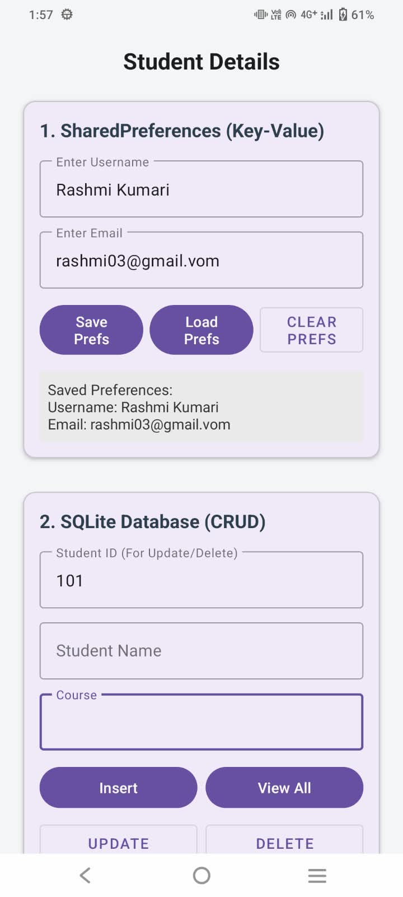
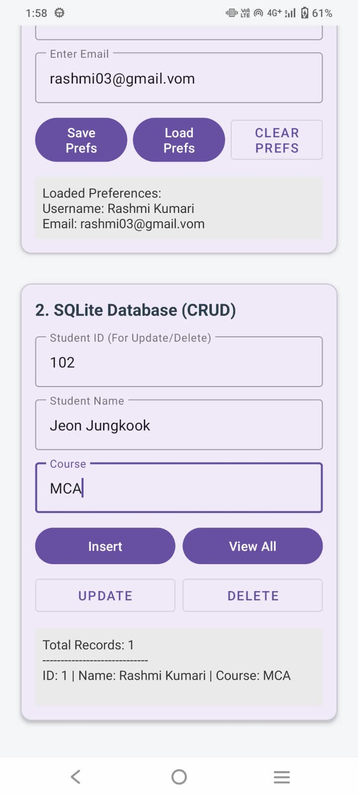
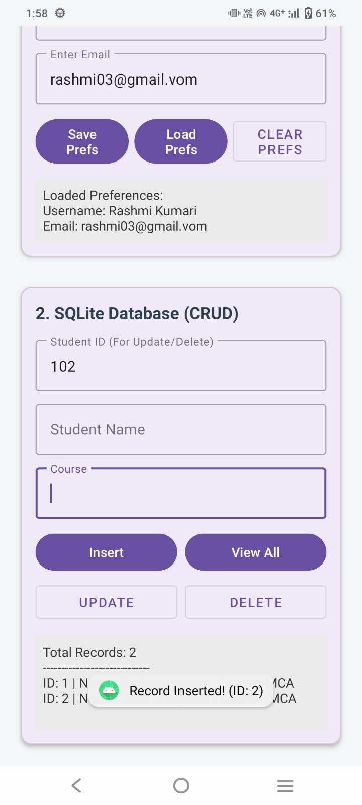

# Experiment 9: Demonstrate Data Persistence Using SharedPreferences and SQLite in Android Studio

## 📱 Experiment Details

- **Experiment Number:** 9
- **Experiment Name:** Data Persistence Using SharedPreferences and SQLite
- **Platform:** Android Studio
- **Programming Language:** Kotlin
- **Database:** SQLite
- **Package Name:** `com.example.datapersistenceapp`

## 🎯 Aim

To develop an Android application that demonstrates data persistence using SharedPreferences and SQLite, enabling the application to store, retrieve, and maintain information locally even after it is closed and reopened.

## 🧠 Objectives

- Understand data persistence in Android applications.
- Store simple key-value data using SharedPreferences.
- Create and manage a local SQLite database.
- Insert and retrieve student records from SQLite.
- Verify that saved information persists across application sessions.

## 📚 Theory

### 1. Data Persistence

Data persistence is the process of saving information so that it remains available after an application is closed or the device is restarted.

### 2. SharedPreferences

SharedPreferences stores small amounts of data as key-value pairs. It is useful for saving usernames, application settings, and login preferences.

### 3. SQLite

SQLite is a lightweight relational database available on Android. It stores structured data in tables and supports operations such as INSERT, SELECT, UPDATE, and DELETE.

## ⚙️ Technologies Used

- Android Studio
- Kotlin
- XML
- SharedPreferences
- SQLite
- Android SDK

## 📂 Project Structure

The following structure matches the Android Studio project shown in the screenshot.

```text
DataPersistenceApp/
├── app/
│   └── src/
│       └── main/
│           ├── java/
│           │   └── com/
│           │       └── example/
│           │           └── datapersistenceapp/
│           │               ├── DatabaseHelper.kt
│           │               └── MainActivity.kt
│           ├── res/
│           │   └── layout/
│           │       └── activity_main.xml
│           └── AndroidManifest.xml
├── build.gradle.kts
└── README.md
```

## 💻 Source Code

### 1. DatabaseHelper.kt

This file creates the SQLite database and provides methods to insert and retrieve student records.

```kotlin
package com.example.datapersistenceapp

import android.content.ContentValues
import android.content.Context
import android.database.sqlite.SQLiteDatabase
import android.database.sqlite.SQLiteOpenHelper

class DatabaseHelper(context: Context) :
    SQLiteOpenHelper(context, "StudentDB", null, 1) {

    override fun onCreate(db: SQLiteDatabase) {
        db.execSQL(
            """
            CREATE TABLE students (
                id INTEGER PRIMARY KEY AUTOINCREMENT,
                name TEXT NOT NULL,
                age INTEGER NOT NULL
            )
            """.trimIndent()
        )
    }

    override fun onUpgrade(
        db: SQLiteDatabase,
        oldVersion: Int,
        newVersion: Int
    ) {
        db.execSQL("DROP TABLE IF EXISTS students")
        onCreate(db)
    }

    fun insertStudent(name: String, age: Int): Boolean {
        val db = writableDatabase
        val values = ContentValues().apply {
            put("name", name)
            put("age", age)
        }

        val result = db.insert("students", null, values)
        db.close()

        return result != -1L
    }

    fun getAllStudents(): String {
        val db = readableDatabase
        val cursor = db.rawQuery(
            "SELECT id, name, age FROM students",
            null
        )

        val result = StringBuilder()

        cursor.use {
            while (it.moveToNext()) {
                val id = it.getInt(0)
                val name = it.getString(1)
                val age = it.getInt(2)

                result.append(
                    "ID: $id | Name: $name | Age: $age\n\n"
                )
            }
        }

        db.close()

        return if (result.isEmpty()) {
            "No student records found."
        } else {
            result.toString()
        }
    }
}
```

### 2. MainActivity.kt

This file demonstrates SharedPreferences and SQLite operations through the application interface.

```kotlin
package com.example.datapersistenceapp

import android.app.Activity
import android.os.Bundle
import android.widget.Button
import android.widget.EditText
import android.widget.TextView
import android.widget.Toast

class MainActivity : Activity() {

    private lateinit var databaseHelper: DatabaseHelper

    override fun onCreate(savedInstanceState: Bundle?) {
        super.onCreate(savedInstanceState)
        setContentView(R.layout.activity_main)

        databaseHelper = DatabaseHelper(this)

        val etUsername = findViewById<EditText>(R.id.etUsername)
        val btnSavePreference =
            findViewById<Button>(R.id.btnSavePreference)
        val tvPreference =
            findViewById<TextView>(R.id.tvPreference)

        val etStudentName =
            findViewById<EditText>(R.id.etStudentName)
        val etStudentAge =
            findViewById<EditText>(R.id.etStudentAge)
        val btnInsert =
            findViewById<Button>(R.id.btnInsert)
        val btnView =
            findViewById<Button>(R.id.btnView)
        val tvStudents =
            findViewById<TextView>(R.id.tvStudents)

        // SharedPreferences
        val preferences = getSharedPreferences(
            "MyPreferences",
            MODE_PRIVATE
        )

        etUsername.setText(
            preferences.getString("username", "")
        )

        tvPreference.text =
            "Saved username: ${
                preferences.getString("username", "Not saved")
            }"

        btnSavePreference.setOnClickListener {
            val username = etUsername.text.toString().trim()

            if (username.isEmpty()) {
                Toast.makeText(
                    this,
                    "Please enter a username",
                    Toast.LENGTH_SHORT
                ).show()
            } else {
                preferences.edit()
                    .putString("username", username)
                    .apply()

                tvPreference.text = "Saved username: $username"

                Toast.makeText(
                    this,
                    "Preference saved successfully",
                    Toast.LENGTH_SHORT
                ).show()
            }
        }

        // SQLite: Insert student
        btnInsert.setOnClickListener {
            val name = etStudentName.text.toString().trim()
            val ageText = etStudentAge.text.toString().trim()
            val age = ageText.toIntOrNull()

            if (name.isEmpty() || age == null || age <= 0) {
                Toast.makeText(
                    this,
                    "Enter a valid name and age",
                    Toast.LENGTH_SHORT
                ).show()
            } else {
                val inserted =
                    databaseHelper.insertStudent(name, age)

                if (inserted) {
                    Toast.makeText(
                        this,
                        "Student inserted successfully",
                        Toast.LENGTH_SHORT
                    ).show()

                    etStudentName.text.clear()
                    etStudentAge.text.clear()
                } else {
                    Toast.makeText(
                        this,
                        "Failed to insert student",
                        Toast.LENGTH_SHORT
                    ).show()
                }
            }
        }

        // SQLite: Retrieve student records
        btnView.setOnClickListener {
            tvStudents.text = databaseHelper.getAllStudents()
        }
    }
}
```

### 3. activity_main.xml

Create or replace `app/src/main/res/layout/activity_main.xml` with the following layout. It provides input fields and buttons for both storage mechanisms.

```xml
<?xml version="1.0" encoding="utf-8"?>
<ScrollView xmlns:android="http://schemas.android.com/apk/res/android"
    android:layout_width="match_parent"
    android:layout_height="match_parent">

    <LinearLayout
        android:layout_width="match_parent"
        android:layout_height="wrap_content"
        android:orientation="vertical"
        android:padding="20dp">

        <TextView
            android:layout_width="match_parent"
            android:layout_height="wrap_content"
            android:text="Data Persistence App"
            android:textSize="24sp"
            android:textStyle="bold"
            android:gravity="center"
            android:padding="12dp" />

        <TextView
            android:layout_width="wrap_content"
            android:layout_height="wrap_content"
            android:text="SharedPreferences"
            android:textSize="20sp"
            android:textStyle="bold"
            android:paddingTop="16dp" />

        <EditText
            android:id="@+id/etUsername"
            android:layout_width="match_parent"
            android:layout_height="wrap_content"
            android:hint="Enter username"
            android:inputType="textPersonName" />

        <Button
            android:id="@+id/btnSavePreference"
            android:layout_width="match_parent"
            android:layout_height="wrap_content"
            android:text="Save Preference" />

        <TextView
            android:id="@+id/tvPreference"
            android:layout_width="match_parent"
            android:layout_height="wrap_content"
            android:text="Saved username:"
            android:padding="8dp" />

        <TextView
            android:layout_width="wrap_content"
            android:layout_height="wrap_content"
            android:text="SQLite Database"
            android:textSize="20sp"
            android:textStyle="bold"
            android:paddingTop="20dp" />

        <EditText
            android:id="@+id/etStudentName"
            android:layout_width="match_parent"
            android:layout_height="wrap_content"
            android:hint="Enter student name"
            android:inputType="textPersonName" />

        <EditText
            android:id="@+id/etStudentAge"
            android:layout_width="match_parent"
            android:layout_height="wrap_content"
            android:hint="Enter student age"
            android:inputType="number" />

        <Button
            android:id="@+id/btnInsert"
            android:layout_width="match_parent"
            android:layout_height="wrap_content"
            android:text="Insert Student" />

        <Button
            android:id="@+id/btnView"
            android:layout_width="match_parent"
            android:layout_height="wrap_content"
            android:text="View Students" />

        <TextView
            android:id="@+id/tvStudents"
            android:layout_width="match_parent"
            android:layout_height="wrap_content"
            android:text="Student records will appear here"
            android:padding="12dp"
            android:textSize="16sp" />

    </LinearLayout>
</ScrollView>
```

## ▶️ Steps to Execute

1. Open the `DataPersistenceApp` project in Android Studio.
2. Open `MainActivity.kt` and add the SharedPreferences and SQLite interaction code.
3. Open `DatabaseHelper.kt` and add the database creation, insertion, and retrieval methods.
4. Add the XML layout to `res/layout/activity_main.xml`.
5. Ensure the package name in both Kotlin files matches your actual project package.
6. Click **Sync Project with Gradle Files** if required.
7. Run the application on an emulator or Android device.
8. Enter a username and click **Save Preference**.
9. Enter a student name and age, then click **Insert Student**.
10. Click **View Students** to display saved records.
11. Close and reopen the application. Verify that the username is restored and that the student records remain available.

## 🧪 Sample Test Cases

| Test | Input / Action | Expected Output |
|---|---|---|
| 1 | Username: Rashmi | Preference saved successfully |
| 2 | Reopen application | Username: Rashmi |
| 3 | Name: Rahul, Age: 21 | Student inserted successfully |
| 4 | Click View Students | Student record appears |
| 5 | Reopen application and view records | Previously inserted student remains available |

## 📸 Screenshots

## 💜 SharedPreferences Output

Demonstrates saving and loading username and email using SharedPreferences.



---

## 🗃️ SQLite Database Output

Displays the SQLite database interface with student details and the stored record.



---

## ➕ SQLite Insert Operation

Demonstrates inserting a new student record and displaying the updated total number of records.



---


## 📊 Difference Between SharedPreferences and SQLite

| Feature | SharedPreferences | SQLite |
|---|---|---|
| Storage type | Key-value pairs | Relational database |
| Suitable for | Settings and preferences | Structured records |
| Example | Username | Student name and age |
| Query support | No SQL queries | SQL queries supported |
| Persistence | Data survives app restarts | Data survives app restarts |

## ✅ Result

The Android application demonstrates data persistence using SharedPreferences and SQLite. SharedPreferences stores and retrieves a username, while SQLite stores and retrieves student records. The stored information remains available after restarting the application.

## 📌 Conclusion

This experiment demonstrates two important local storage mechanisms in Android. SharedPreferences is useful for small configuration values, whereas SQLite is suitable for structured data management. Both methods allow an application to preserve information across sessions without requiring an internet connection.
